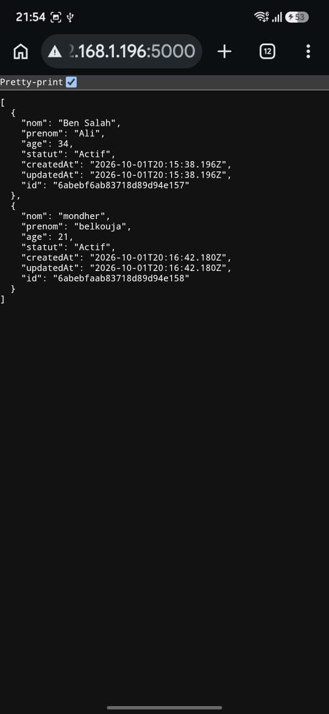
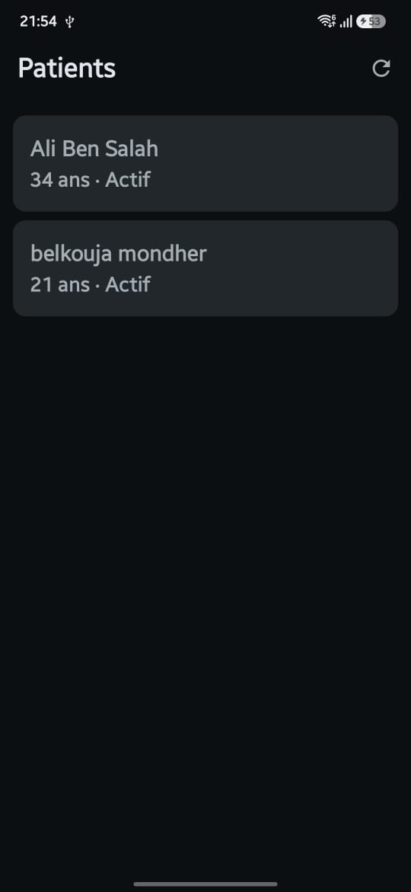
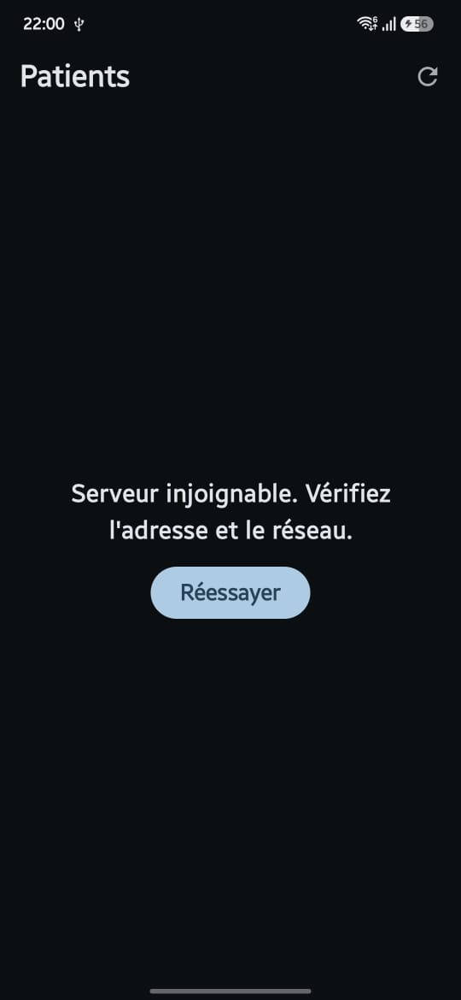

# Application Android de gestion des patients — Partie A

Cette application Android consomme une API REST de gestion des patients. Elle a été réalisée avec Kotlin, Jetpack Compose, Retrofit et l’architecture MVVM.

## Vérification de l’API

L’API a été testée depuis un navigateur sur le réseau local. La route `GET /api/patients` renvoie la liste des patients :

## Application avec le serveur actif

Lorsque le serveur Node.js est lancé et que le téléphone et l’ordinateur sont connectés au même réseau Wi-Fi, l’application récupère et affiche les patients :

## Gestion de l’indisponibilité du serveur

Lorsque le serveur est arrêté, l’application affiche un message indiquant qu’il est injoignable. Cela montre que l’erreur réseau est prise en charge :

## Lancer le projet

1. Démarrer l’API du TP1 avec `npm run dev`.
2. Vérifier que l’adresse de l’API dans l’application correspond à l’adresse IP de l’ordinateur et au port `5000`.
3. Lancer l’application depuis Android Studio.

> Les captures montrent un test effectué sur le réseau local. L’adresse IP `192.168.1.196` est une adresse privée et peut varier selon le réseau.